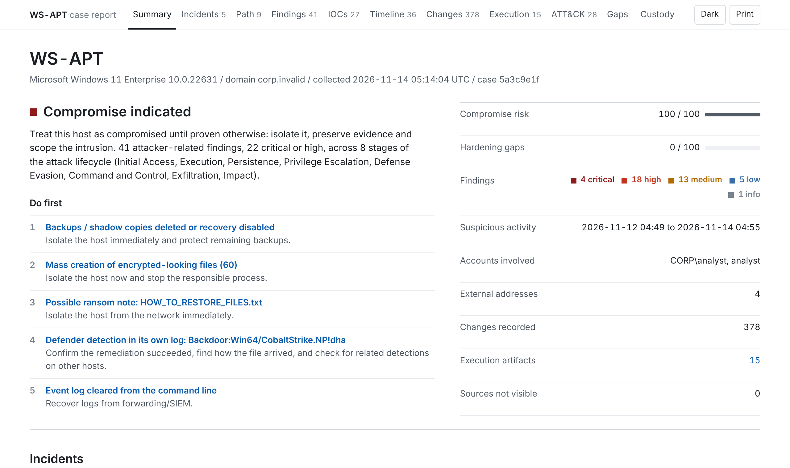
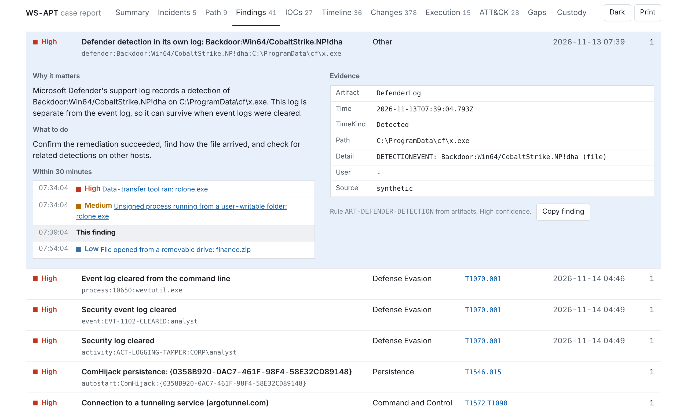
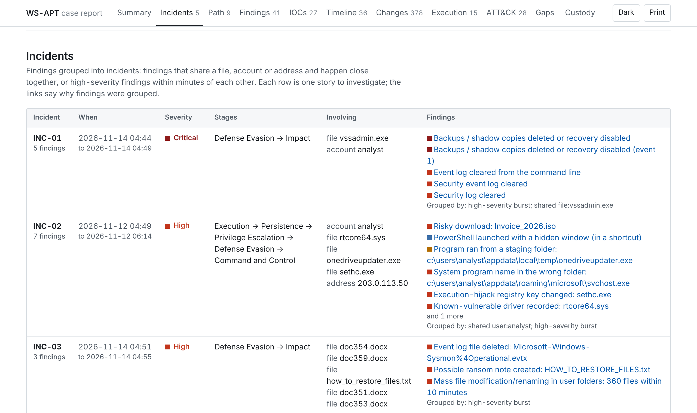

# WinForensicX

**Read-only incident triage and investigation for Windows, in plain PowerShell.**

One command collects the state of a Windows host, checks it against detection rules mapped to MITRE ATT&CK,
and writes a case report you can hand to a colleague. Around that core is a toolkit for the rest of the job:
57 live views of the machine, execution artifacts (Amcache, ShimCache, Jump Lists, ShellBags …) from the
live host or a KAPE folder, Sigma and YARA, incident grouping, IOC hunting, file triage, payload decoding,
timelines, case diffing, and exports to Timesketch, Elastic (ECS) and STIX 2.1.

No install, no external modules, no network traffic of its own. Windows PowerShell 5.1 or PowerShell 7+.



<sub>Sample report from a synthetic APT scenario (no real host): [`examples/sample-report.html`](examples/sample-report.html).</sub>

---

## Contents

- [Quick start](#quick-start)
- [The case report](#the-case-report)
- [Explore: live views with flags](#explore-live-views-with-flags)
- [Evidence of execution](#evidence-of-execution)
- [Commands](#commands)
- [What it detects](#what-it-detects)
- [Sigma, YARA and exports](#sigma-yara-and-exports)
- [Case folder and chain of custody](#case-folder-and-chain-of-custody)
- [Safety boundaries](#safety-boundaries)
- [Tuning](#tuning)
- [Testing](#testing)
- [Limitations](#limitations)

---

## Quick start

1. **Download and extract the whole archive.** Optionally [verify the hashes](#verifying-the-download).
2. **Open PowerShell as administrator** (Start → type *PowerShell* → *Run as administrator*). Admin rights
   give access to the Security log, every process, Prefetch, the NTFS change journal and BitLocker state.
   Without them the tool still runs and lists what it could not see.
3. **Start it from that window:**

   ```powershell
   cd "$HOME\Downloads\WinForensicX-3.0.0"
   .\Start-WinForensicX.ps1
   ```

   | If PowerShell says | Do this |
   |---|---|
   | *running scripts is disabled on this system* | `Set-ExecutionPolicy -Scope Process -ExecutionPolicy Bypass`, then run it again. It applies to this window only. |
   | *…is not digitally signed* | The files still carry the downloaded-from-the-Internet mark. After checking the hashes: `Get-ChildItem -Recurse \| Unblock-File`. |

   > Right-click → **Run with PowerShell** is not supported: it never runs as administrator and closes the
   > window as soon as PowerShell refuses, so all you see is a window flashing open and shut.

4. **Pick from the menu:**

   ```
     1  Investigate this computer    triage: find signs of compromise and get a report
     2  Explore this computer        57 live views: what changed recently, users, software, network, USB...
     3  Hunt & analyze               IOC hunting, file triage, decode payloads
     4  Cases & evidence             open reports, verify, timeline, compare
     5  Live monitor                 watch new processes / connections as they happen
     6  Settings                     output folder, look-back, allowlist, custom rules
     H  Help & guide                 the field guide, in your browser
   ```

   **B** goes back and **Q** quits from anywhere. Output goes to `Desktop\WinForensicX` unless you change it
   in Settings; for real evidence, use an external drive.

Prefer commands? `Import-Module .\WinForensicX\WinForensicX.psd1`, then `Invoke-WfxTriage`.
For a USB stick or a remote host, copy the single file `dist\WinForensicX.ps1`.

The full field guide (investigations step by step, how to read each flag, every view and command) is
[`docs/guide.html`](docs/guide.html), also opened with **H** in the menu.

---

## The case report

`report.html` is a single offline file: no external assets, a strict Content-Security-Policy, and every
evidence value escaped. It opens in any browser, including inside Windows Sandbox or on an isolated
analysis machine.

| Section | What you get |
|---|---|
| **Summary** | A verdict in words, a numbered *Do first* list with the action for each item, the suspicious-activity window, accounts involved, external addresses, compromise risk and hardening scores. |
| **Incidents** | Findings that share a file, account or address within hours (or a burst of high-severity findings) grouped into one story, with the ATT&CK stages it covers and why each finding was joined. |
| **Attack path** | Findings placed on the ATT&CK lifecycle, earliest stage first, with the time each stage was first seen. |
| **Findings** | Sortable and filterable by severity, stage and area. Each row opens to show why it matters, what to do, the evidence, the rule and source, and **everything else that happened within 30 minutes**. |
| **Evidence of execution** | Amcache, ShimCache, Prefetch, BAM, Jump Lists, shortcuts, ShellBags, browser downloads and Defender logs, filterable by artifact and evidence kind, with flagged rows linked to their finding. CSV export. |
| **Indicators** | IPs, domains, URLs, hashes, files, registry keys and accounts pulled from attacker-related findings. Defang for sharing, copy, or download as CSV. |
| **Timeline / Changes** | Findings and recent changes grouped by day; CSV export. |
| **ATT&CK** | Technique matrix, with a layer you can load into MITRE ATT&CK Navigator. |
| **Not visible** | Collection gaps and allowlisted findings, so "nothing found" is never mistaken for "nothing there". |
| **Custody** | Case ID, operator, parameters and hashes, with the `Test-WfxCase` command to verify the folder. |

Dark mode, phone width and print are supported. CSV exports neutralise spreadsheet formulas.





---

## Explore: live views with flags

Instant, read-only answers without a full triage. Every view can be filtered, opened as a sortable table in
the browser, exported to CSV, or saved all together as a hashed inventory report.

Views that can show attacker activity run the same analyzers as triage over each row and add **Flag**
(CRITICAL / HIGH / MEDIUM / LOW), **Why**, **Technique** and **Rule**. **S** shows flagged rows only.


| Group | Views |
|---|---|
| **Evidence of execution** | What ran (Amcache, ShimCache, Prefetch, BAM, UserAssist, PCA, with SHA-1 where recorded); user activity (Jump Lists, shortcuts, ShellBags, RunMRU, typed paths, Explorer searches); browser downloads with source URL; Defender support logs |
| **Recent changes** | Combined timeline; registry writes in persistence and security keys; NTFS change journal (created, deleted, modified, renamed, alternate streams, timestamps); deleted files (Recycle Bin, Sysmon); software and driver installs; programs that ran (Prefetch, BAM, UserAssist); connection history; security configuration changes |
| System | Overview, updates, software, users, privileged groups, sessions, profiles, shares, USB history, drives and BitLocker |
| Processes | All processes (signer, owner, parent, command line), process tree, unsigned or user-folder programs |
| Network | Listening ports, connections (named from the DNS cache), DNS cache, adapters, routes, ARP, hosts file, proxy, Wi-Fi profiles, firewall rules, SMB sessions |
| Persistence | Autostarts, non-standard services and drivers, scheduled tasks, WMI subscriptions |
| Events | Logons, failed logons, RDP, account and group changes, new services, cleared logs, reboots and crashes, suspicious PowerShell, Defender detections |
| Files | Downloads with source URL, new programs in user folders, Prefetch, recent files, PowerShell history (redacted), Run-dialog history |
| Security | Posture checklist (AV, tamper protection, firewall, UAC, LSA, Credential Guard, WDigest, SMBv1, LLMNR, logging, Sysmon, RDP NLA, auto-logon, patch age) with fixes |

**How "recent changes" works with no prior monitoring:** Windows already keeps the evidence. Registry keys
have last-write times, the NTFS change journal records file operations, the Recycle Bin keeps original
paths and deletion times, Prefetch/BAM/UserAssist record program runs, and the event logs record installs,
services, tasks, accounts and policy changes. Sources that are not enabled (Sysmon, WFP auditing, the
firewall log) are reported as gaps.

---

## Evidence of execution

`Get-WfxArtifact` parses the artifacts investigators reach for first and returns one normalised record per
entry: **Artifact, Time, TimeKind** (what the time actually means), **Evidence** (Execution, Presence,
Access, Download, Detection, Install), **Path, Name, Sha1, User, Detail, Source**.

| Artifact | Source | Proves |
|---|---|---|
| Amcache | `Amcache.hve`: files (SHA-1), programs, drivers | Presence, often execution; the hash identifies the binary even after it is deleted |
| ShimCache | `SYSTEM` AppCompatCache (Win7 – 11) | Presence on disk; order and last-modified time |
| Prefetch, BAM, UserAssist, PCA | Prefetch folder, `SYSTEM`, `NTUSER.DAT`, `C:\Windows\appcompat\pca` | Execution, with last-run times and counts |
| Jump Lists, shortcuts | `AutomaticDestinations`, `CustomDestinations`, `Recent\*.lnk` | Files and folders opened, with target times, volume serial, machine and **arguments** |
| ShellBags | `UsrClass.dat`, `NTUSER.DAT` | Folders browsed, including removable drives, network and admin shares |
| RunMRU, typed paths, searches | `NTUSER.DAT` | Commands typed in Run (checked by the command-line rules), Explorer paths and searches |
| Browser downloads | Chrome, Edge, Brave, Opera, Vivaldi `History`; Firefox `places.sqlite` | What was downloaded, from where (URL chain and referrer), and where it went |
| Defender logs | `MPLog-*.log`, `MPDetection-*.log` | Detections and the files Defender saw, even after the event log was cleared |

```powershell
Get-WfxArtifact -Flag | Where-Object Flag                          # this computer (administrator)
Get-WfxArtifact -Path D:\kape\C -Flag | Export-Csv art.csv         # a KAPE / Velociraptor collection or mounted image
Invoke-WfxTriage -ArtifactPath D:\kape\C -CaseName ctf-01          # full case report from a collection
Invoke-WfxHunt -ArtifactPath D:\kape\C -Ioc 'e3b0c442…'            # hashes, URLs and paths across the artifacts
```

The parsers are written from the file-format specifications in plain PowerShell: registry hives (with
`.LOG1/.LOG2` transaction-log replay in memory), compound files, shell links, shell items and SQLite. Files
are recognised by content, so renamed hives work. Nothing is loaded into the registry, executed or modified.
Every record is checked by the triage rules: offensive, exfiltration and remote-management tools, system-name
masquerading, execution from staging folders, known-vulnerable drivers, risky downloads, admin-share and
removable-drive access, encoded or LOLBin arguments in shortcuts and Run history, sensitive searches.

---

## Commands

| Command | Purpose |
|---|---|
| `Invoke-WfxTriage` | Collect → analyze → score → report. **Local**, **remote** (`-ComputerName`, WinRM), **offline** (`-EvtxPath`) or **re-analyze** (`-InputPath`). |
| `Save-WfxEvidence` | Collect a hashed evidence bundle now; analyze later, anywhere. |
| `Invoke-WfxAnalyze` | Run every analyzer over a bundle. Runs on Windows, Linux and macOS. |
| `Get-WfxArtifact` | Execution and user-activity artifacts from this computer or a folder of collected files. |
| `Get-WfxInsight` / `Save-WfxInsight` | The 57 live views / export them all as a hashed inventory report. |
| `Get-WfxActivity` | What changed recently; `-Journal` adds the NTFS change journal. |
| `Invoke-WfxHunt` | Sweep a host or saved case for IOCs (hashes, IPs, domains and subdomains, strings), including event logs. Accepts defanged values and IOC files. |
| `Get-WfxFileTriage` | "What is this file?" Hashes, true type vs. extension, entropy, download URL (Mark of the Web), alternate streams, signer, PE facts, strings and IOCs. Never executes it. |
| `ConvertFrom-WfxEncodedCommand` | Decode `-EncodedCommand`, Base64, gzip and nested `FromBase64String` payloads, then run the rules over the result. |
| `Export-WfxTimeline` | UTC super-timeline of a case (findings, events, changes and artifacts) to CSV or JSON. |
| `Export-WfxCase` | A case as Timesketch CSV, Elastic Common Schema NDJSON, STIX 2.1 bundle or an indicator CSV. |
| `New-WfxFleetReport` | One HTML report across many cases: hosts by risk, findings seen on several hosts, shared indicators, ATT&CK stages. |
| `Compare-WfxCase` | Diff two cases: new processes, autostarts, services, listeners, DNS names, findings. |
| `New-WfxFileBaseline` / `Compare-WfxFileBaseline` | File-integrity baseline for chosen folders. |
| `Test-WfxCase` | Re-hash a case against its manifest: changed, missing or added files. |
| `Start-WfxMonitor` | Live baseline, then alerts on new suspicious processes, connections and beaconing. |
| `Show-WfxMenu` / `Show-WfxHelp` | The menu; help in the terminal or (`-Html`) in the browser. |

```powershell
Invoke-WfxTriage -OutputPath E:\cases                              # triage this host to external media
Invoke-WfxTriage -FileScan -ExposureScan -OutputPath E:\cases      # plus web roots, drop folders, exposed secrets
Invoke-WfxTriage -ComputerName srv01,srv02 -Credential (Get-Credential)
Invoke-WfxTriage -EvtxPath D:\evidence\logs                        # exported .evtx only
Invoke-WfxTriage -ArtifactPath D:\kape\C                           # collected hives, Amcache, Jump Lists, browsers, .evtx
Invoke-WfxTriage -SigmaPath D:\sigma\rules\windows -YaraRules D:\yara\rules
Invoke-WfxTriage -InputPath .\WFX_PC01_20261103-101500Z -AllowlistPath .\allowlist.json

Invoke-WfxHunt -Ioc 'evil[.]example','203.0.113.7' -InputPath .\case
Get-ChildItem $env:USERPROFILE\Downloads -File | Get-WfxFileTriage | Where-Object ExtensionMismatch
ConvertFrom-WfxEncodedCommand 'powershell -nop -enc VwByAGkAdABlAC0ATwB1AHQAcAB1AHQAIAAnAGgAaQAnAA=='
Compare-WfxCase -Baseline .\golden -Current .\today | Where-Object Change -eq 'Added'
Export-WfxCase -InputPath .\case -Format All                       # Timesketch, ECS, STIX 2.1, indicators
New-WfxFleetReport -Path E:\cases                                  # every host's latest case on one page
```

---

## What it detects

| Area | Examples |
|---|---|
| **Command lines** (49 rules) | Encoded PowerShell (decoded and re-scanned), download cradles, AMSI tampering, LOLBin proxy execution (certutil, mshta, regsvr32, rundll32, MSBuild …), LSASS dumping, hive and NTDS export, Kerberoasting, shadow-copy deletion, log clearing, port proxies, SSH tunnels, ClickFix lures. Matched on the original **and** a normalised form, so carets, en-dashes, split quotes and `/switch` spellings do not evade them. |
| **Processes** | System-name masquerading, renamed interpreters, parent spoofing, Office or browsers spawning shells, unsigned programs in user folders, offensive and remote-management tools, AI agents |
| **Persistence** | Run keys, Startup, services, drivers (including known-vulnerable BYOVD drivers), tasks, WMI, Winlogon, AppInit, IFEO, LSA packages, COM hijacks |
| **Event logs** (20 rules) | Spraying and brute force (including spray-then-success by source), log clearing, new services and tasks, 4688 / Sysmon 1 command lines, 4104 script blocks, account and group changes, external RDP, Defender detections and tampering, LSASS access |
| **Network and DNS** | Listeners on all interfaces, tunnels (ngrok, Cloudflare …), C2 ports, DGA-like names, risky TLDs, paste sites, beaconing |
| **Files** (`-FileScan`) | Web shells, double extensions, downloaded executables, packed binaries, ransom notes, mass encryption |
| **Exposed secrets** (`-ExposureScan`) | GPP passwords, unattend files, readable SAM/SYSTEM (HiveNightmare), cloud and API keys, unencrypted SSH keys. Reported redacted to *type + length*. |
| **Recent activity** | Defender exclusions, hijack keys, weakened LSA/WDigest, timestomping, time changes, mass deletion or modification bursts |
| **Execution artifacts** | Offensive, exfiltration and remote-management tools by name or Amcache hash, masquerading, staging-folder execution, vulnerable drivers, risky downloads, admin-share and USB access, encoded arguments in shortcuts, Jump Lists and Run history, Defender detections from support logs |
| **Posture** | AV state, tamper protection, auditing, Sysmon, firewall, RDP without NLA, LSASS protection |

**Two scores.** *Compromise risk* comes only from evidence of attacker activity; *posture* comes from
hardening and visibility gaps. A clean but unhardened host shows low risk, not "compromised". Both use
`1 − Π(1 − wᵢ/40)`, so a pile of weak leads cannot add up to a critical.

**Incidents.** Findings that share a file, account or public address within six hours, or High/Critical
findings within twenty minutes of each other, are grouped into incidents. Every link records why it was made.

---

## Sigma, YARA and exports

- **Sigma.** Point `-SigmaPath` (or `WFX_SIGMA`, or Settings in the menu) at a folder of Sigma rules, for
  example `rules/windows` from SigmaHQ. Rules are read as data and compiled to the tool's own matcher: field
  modifiers (`contains`, `startswith`, `endswith`, `re`, `all`, `cidr`, `base64`, `base64offset`, `windash`,
  `exists`), full conditions (`1 of selection_*`, `all of them`, `not`, parentheses). Rules add the
  Security and System event IDs they need to collection. 4688 events are mapped to Sysmon field names. Of the
  2,427 SigmaHQ Windows rules, 2,229 load; the rest (aggregations, correlations, unsupported log sources)
  are listed as a gap with the reason. Matches become `SIGMA-…` findings with the rule's level and ATT&CK tags.
- **YARA** (optional). `-YaraRules` (or `WFX_YARA`) runs a `yara` executable *you* installed (`-YaraExe`,
  `WFX_YARA_EXE` or PATH) over running programs, autostarts, flagged files and artifact paths — or over the
  whole `-ArtifactPath` folder. Matches become `YARA-<rule>` findings. Without yara, a gap says so.
- **Exports.** `Export-WfxCase -Format Timesketch|Ecs|Stix|Indicators|All` writes next to the case:
  `*-timesketch.csv` (import into Timesketch), `*-ecs.ndjson` (Elastic / OpenSearch bulk-ready, ECS fields),
  `*-stix.json` (STIX 2.1 bundle: indicators with patterns, ATT&CK attack-patterns, a report; ids are
  deterministic so re-exports match) and `*-indicators.csv`. The case manifest is not touched, so
  `Test-WfxCase` still verifies.
- **Fleet.** `New-WfxFleetReport -Path <folder of cases>` reads each host's latest case (`-AllCases` for all)
  and writes one offline HTML page: hosts ranked by risk, findings and indicators seen on more than one host,
  and which ATT&CK stages appeared where.

---

## Case folder and chain of custody

```
WFX_<host>_<utc>Z/
├─ report.html       the case report (offline, self-contained)
├─ result.json       findings, scores, ATT&CK coverage, gaps, case metadata
├─ findings.csv      flat view for a spreadsheet or SIEM
├─ raw/bundle.json   normalised evidence, UTC; re-analyse with -InputPath
├─ audit.log         every step the tool took, with timings
└─ manifest.json     written last: SHA-256 of every file, tool and rule hashes, parameters
```

Once the manifest is written the case is closed. `Test-WfxCase` detects any changed, missing or added
file. The manifest is not signed, so record its SHA-256 (printed at the end of each run) in your ticket or
evidence log.

---

## Safety boundaries

- **Read-only.** It changes no settings and executes nothing it finds. Its only writes are its own case folder.
- **Secrets are audited, never extracted.** No LSASS dumping, no SAM/NTDS hash parsing, no DPAPI or browser
  decryption. Command lines and file contents are scrubbed of secrets at collection time.
- **No network traffic of its own.** Remote mode uses the WinRM session you start; `-ExposureScan` reads
  the domain SYSVOL share.
- PowerShell 7 itself sends anonymous start-up telemetry unless `POWERSHELL_TELEMETRY_OPTOUT=1` is set.
  Windows PowerShell 5.1 does not.
- Reading files can update NTFS last-access times. Write cases to external media for evidence work.

See [SECURITY.md](SECURITY.md).

### Antivirus warnings

The rule packs contain the names and command-line patterns of attacker tools so they can be detected, and the
tool reads security-sensitive locations. Heuristic scanners sometimes flag that. The code is plain, readable
PowerShell with no obfuscation, downloads or encoded payloads. **Do not turn off your antivirus.** Verify the
hashes, read the flagged file, and report the false positive to the vendor.

### Verifying the download

```powershell
Get-Content .\SHA256SUMS.txt | ForEach-Object {
  $h, $f = $_ -split '  ', 2
  if ((Get-FileHash -Algorithm SHA256 -LiteralPath $f).Hash -ne $h) { "CHANGED: $f" }
}
```

No output means every file matches the release.

### Two packages

| Package | For | Contains |
|---|---|---|
| `WinForensicX-<version>.zip` | Investigators and CTF players | The toolkit, single-file build, rules, guide and examples |
| `WinForensicX-<version>-source.zip` | Developers and reviewers | All of the above plus `tests\` and the scenario suite |

The test data contains realistic attacker command lines as plain text, which antivirus engines often flag.
Nothing in it runs. If you only want to use the tool, take the main package.

---

## Tuning

- **Allowlist** (`-AllowlistPath`, `$env:WFX_ALLOWLIST`, or Settings in the menu): a JSON array of
  `{ "Id", "Entity", "Host", "Reason" }` with `-like` wildcards. Allowlisted findings stay visible in the
  report with their reason. Example: [`examples/allowlist.example.json`](examples/allowlist.example.json).
- **Custom rule packs** (`$env:WFX_RULES`): every rule is validated on load and every regex runs with a
  250 ms timeout. See [docs/RULES.md](docs/RULES.md).

---

## Testing

```powershell
Invoke-Pester ./tests                                                # 143 tests, including the scenario suite
pwsh -File tools/Invoke-WfxScenarioSuite.ps1 -OutputPath .\results   # add -SingleFile to test dist\WinForensicX.ps1
Invoke-ScriptAnalyzer -Path ./WinForensicX -Recurse -Settings ./PSScriptAnalyzerSettings.psd1
pwsh -File tools/build.ps1                                           # builds dist\WinForensicX.ps1
pwsh -File tools/build-guide.ps1                                     # builds docs\guide.html
```

The **scenario suite** feeds synthetic evidence for ten scenarios through every workflow: a clean and a busy
admin workstation (false-positive controls), phishing malware, a LOLBin chain, a hands-on-keyboard intrusion,
credential theft, a multi-day APT ending in ransomware, malware-free lateral movement, ClickFix and AI-tool
abuse, and malformed or hostile evidence, now with execution artifacts in each. It also runs 42 evasion
variants against 15 benign look-alikes: 339 checks in all. It checks the report, manifest, tamper detection, timeline, hunt and Explore flags.
Nothing is executed; the evidence is data.

The artifact parsers are tested against hives, Jump Lists, shortcuts, compound files and SQLite databases
built byte by byte in the tests, and were cross-checked during development against independent parsers on
public test data (ShimCache and Amcache against regipy, shortcuts against LnkParse3). The STIX export is
checked with the OASIS validator.

Collectors need real Windows. `Invoke-WfxSandboxEmulation.ps1` (shipped separately) plants harmless
look-alike artefacts **inside Windows Sandbox only**, checks each is flagged, and reverts them.

---

## Limitations

- Findings are **leads, not verdicts**. Read them with the *Not visible* section: without process auditing or
  Sysmon, "nothing found" often means "nothing could be seen".
- **Triage, not imaging.** No disk or memory acquisition, no carving of deleted files.
- Live: Amcache is locked by Windows and is reported as a gap (collect it with KAPE or a VSS copy and use
  `-ArtifactPath`); Prefetch is read for names and times only (its compressed contents are not decoded).
  SRUM (an ESE database) and `$MFT` parsing are not included.
- Explore views inspect only loaded user hives (logged-on users); `-ArtifactPath` reads every `NTUSER.DAT`
  and `UsrClass.dat` it is given. Event collection is capped per query, and a cap
  that is hit is reported as a gap.
- Detection is heuristic. Expect some false positives and false negatives; tune with the allowlist and
  custom rules.
- Live collection targets Windows 10/11 and Server 2016+. The 3.0 artifact collectors are verified with the
  Windows Sandbox script; parsing collected files is tested on every platform. Analysis, hunting, timelines, diffs and decoding
  also run on Linux and macOS with PowerShell 7.

## License

MIT. See [LICENSE](LICENSE).
